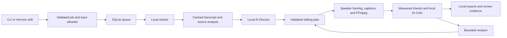

# ERMCLIP

**Turn long videos into captioned clips with local AI, active-speaker framing, and a persistent editing queue.**

ERMCLIP runs transcription, clip selection, rendering, and review on your computer. It uses faster-whisper for speech, a local language model for the AI Director and Critic, and FFmpeg for exports. Hermes can submit and control jobs through the included skill.

The application is a working local MVP. The documented GPU configuration was tested on an RTX 4060 Laptop GPU with 8 GB VRAM. It does not certify editorial accuracy or publish videos automatically. Review the final video and audio before publication.

## Contents

- [Features](#features)
- [Architecture](#architecture)
- [Requirements](#requirements)
- [Install](#install)
- [Create podcast shorts](#create-podcast-shorts)
- [Configuration](#configuration)
- [Captions and layouts](#captions-and-layouts)
- [Outputs and review](#outputs-and-review)
- [Revision workflow](#revision-workflow)
- [Worker operations](#worker-operations)
- [Hermes and Telegram](#hermes-and-telegram)
- [Privacy and cost](#privacy-and-cost)
- [Tests](#tests)
- [Repository guide](#repository-guide)
- [Known limits](#known-limits)
- [Licensing](#licensing)

## Features

| Capability | Behavior |
| --- | --- |
| AUTO editing | Select excerpts from the source transcript. |
| TARGETED editing | Apply keywords, exclusions, and supported content conditions. |
| Full-episode planning | Process eligible long requests in overlapping transcript sections, then rank valid source windows. |
| Podcast defaults | Use the thumbnail-style `podcast_hero` layout, yellow speech captions, and speaker framing for eligible portrait profiles. |
| Active-speaker framing | Follow visible speech using local face tracks and audiovisual activity. Use the full frame when the decision is uncertain. |
| Caption styles | Choose from 25 presets, plus the legacy `highlight`, `plain`, and `pop` presets. |
| Multiple profiles | Share source analysis across portrait, landscape, and compilation exports. |
| Persistent jobs | Store requests, checkpoints, events, controls, and feedback in SQLite. |
| Bounded revisions | Validate proposed changes and allow at most two automatic revision passes. |
| Output evidence | Save source maps, tracking data, subtitles, publishing notes, and quality reports. |
| Local reasoning | Use a loopback model server without cloud fallback. The additional paid API budget is fixed at zero. |

## Architecture



One worker lock serializes heavy jobs. Foreground analysis uses the same lock. The worker runs independently of a Hermes chat and recovers interrupted jobs when it starts again. Recovery uses completed output checkpoints; it does not resume an encoder at an individual frame.

The Director selects validated source windows and cannot invent timestamps. The Critic receives selected speech, layout context, and measured evidence in a separate context. It does not see pixels or hear audio. See [architecture](docs/architecture.md).

## Requirements

| Component | Requirement |
| --- | --- |
| Operating system | Windows. Setup, the managed model server, and service scripts use PowerShell. Other platforms are not validated. |
| Python | Python 3.11 or 3.12 for the documented setup. The package declares Python 3.11 or later. |
| Package installer | `uv` on PATH. |
| Media tools | `ffmpeg` and `ffprobe` on PATH. FFmpeg must support libass and libx264. NVENC is optional. |
| GPU reasoning | NVIDIA GPU and a compatible driver. The tested configuration uses an RTX 4060 with 8 GB VRAM. |
| GPU transcription | Project-local CUDA/cuDNN packages from the `cuda` extra. |
| Speaker tracking | CPU Torch, audio feature packages, and pinned Light-ASD/YuNet assets. |
| Storage | Space for source media, downloaded models, caches, and exports. The worker checks free space. |
| Fonts | Install the font families you use. Font substitution can change layout and line breaks. |

The 9B model shares GPU memory with transcription and other applications. The worker can release its managed model before CUDA transcription and restart it for planning. CPU transcription and encoding are available. The pinned Windows managed reasoning server uses CUDA.

## Install

### 1. Clone and create the environment

Run PowerShell. Replace the Python executable path with your installation.

```powershell
git clone https://github.com/painjanevivek/ERMCLIP.git
Set-Location ERMCLIP
.\scripts\setup.ps1 -PythonPath 'C:\Path\To\Python311\python.exe'
uv pip install --python .venv\Scripts\python.exe -e '.[cuda]'
.\scripts\ermclip.ps1 doctor
```

Setup creates `config/local.json` and runtime directories. This machine-specific settings file is excluded from Git. Keep the root and input paths created for your clone.

### 2. Install the local reasoning model

```powershell
.\.venv\Scripts\python.exe scripts\install_local_model.py --model 9b
```

This explicit installer downloads pinned Qwen3.5 9B Q4_K_M weights and official Windows CUDA llama.cpp binaries. It verifies SHA-256 hashes and saves assets in `cache/local-llm/`. Passing `--model 4b` installs the smaller supported model. The installer also selects 4B when no model argument is supplied.

Apply the portable 9B settings to the initialized local file:

```powershell
$settingsPath = Join-Path $PWD 'config\local.json'
$settings = Get-Content -LiteralPath $settingsPath -Raw | ConvertFrom-Json
$example = Get-Content -LiteralPath 'config\local.example.json' -Raw | ConvertFrom-Json
foreach ($item in $example.PSObject.Properties) {
    $settings | Add-Member -NotePropertyName $item.Name -NotePropertyValue $item.Value -Force
}
$settings | ConvertTo-Json -Depth 30 | Set-Content -LiteralPath $settingsPath -Encoding UTF8
```

The example selects 9B for both roles, Whisper small, and a 40-call ceiling for full-episode jobs. The application's fresh default ceiling is eight calls. A ceiling is a limit; it does not require a job to use that many calls.

### 3. Download speech and speaker assets

```powershell
.\.venv\Scripts\python.exe -c "from faster_whisper.utils import download_model; download_model('small', cache_dir='cache/models')"
.\scripts\setup-speaker.ps1
.\scripts\start-model.ps1
.\scripts\ermclip.ps1 doctor
```

Downloads fetch public assets and do not upload media. Runtime downloads remain disabled in the supplied example. For an offline machine, install dependencies and transfer the required caches before processing. The speaker installer verifies its pinned assets.

The managed server binds to `http://127.0.0.1:8088/v1`, uses a private key in `state/local-model.key`, and runs with `--offline`. Do not expose the endpoint through a public proxy.

## Create podcast shorts

Put a complete video with audio in `input/`. Start the worker and submit:

```powershell
.\scripts\start-worker.ps1
.\scripts\ermclip.ps1 submit .\input\episode.mp4 --podcast --instruction 'Create 5 clips of 60 seconds. Keep each question and its complete answer.'
.\scripts\ermclip.ps1 status
.\scripts\ermclip.ps1 health
```

The submission returns a job ID. Inspect that job with `status <job-id>` and `events <job-id>`.

Podcast mode enables speaker framing and applies the hero layout and short yellow captions to eligible inherited 9:16 profiles. Podcast/interview context in a request or filename can also enable this routing. Register known source paths in `podcast_sources` for repeat use. Routing uses request context; it is not a general video-type classifier.

For explicit durations and episode credit, edit the included profile before submission:

```powershell
.\scripts\ermclip.ps1 submit .\input\episode.mp4 --podcast --profile .\config\podcast.profile.example.json --instruction 'Create 5 complete, distinct excerpts. Keep necessary context.'
```

For precise conditions, copy [the job example](config/job.example.json), set an absolute source path, and use `submit --spec`. Sources outside `input/` require their parent folder in `allowed_inputs`. Permit only the folders you intend to process.

## Configuration

Use `config/local.json` for settings. See [the portable example](config/local.example.json), [settings schema](config/settings.schema.json), [job schema](config/job.schema.json), and [plan schema](config/editing_plan.schema.json).

| Setting | Purpose |
| --- | --- |
| `allowed_inputs` | Permit specific source folders. Use absolute paths outside the clone. |
| `podcast_sources` | Register exact local podcast paths. |
| `watch_folders` | Watch requested folders. File stability does not guarantee a download is complete. |
| `whisper_model` / `whisper_device` | Choose speech weights and `auto`, `cpu`, or `cuda` execution. |
| `allow_model_download` | Permit runtime ASR downloads. Keep `false` after explicit setup. |
| `encoder` | Choose `auto`, `nvenc`, or `cpu`. Auto can fall back to libx264. |
| `local_llm_url` | Use a loopback OpenAI-compatible endpoint. Remote hosts are rejected. |
| `director_model` / `critic_model` | Choose model aliases for the two roles. |
| `managed_local_model` | Let ERMCLIP start its pinned server. |
| `max_model_calls` | Bound reasoning calls per job, including retries and revisions. Maximum: 40. |
| `retries` / `revisions` | Bound job retries and automatic revision passes separately. |
| `defaults` | Set profiles for submissions without an explicit profile. |
| `podcast_layout` / `podcast_caption_preset` | Set inherited podcast presentation. |
| `telegram_enabled` | Enable optional outbound notifications. Disabled in the example. |
| `additional_paid_api_budget` | Fixed at `0`; a nonzero value fails validation. |

Each profile defines ratio, even dimensions, duration bounds, count, framing, and captions. Duration values accept seconds, `5 minutes`, or `HH:MM:SS`. Each output is capped at 900 seconds. Count is a ceiling; insufficient qualifying content can produce fewer clips. Strict durations can cut speech and require review. The editor does not add filler.

Use `strategy: continuous` for one source window per clip, or `compilation` for multiple passages. `total_duration` sets a per-profile budget. See [profile examples](config/profiles.json).

## Captions and layouts

```powershell
.\scripts\ermclip.ps1 caption-styles
.\scripts\ermclip.ps1 caption-gallery
.\scripts\ermclip.ps1 submit .\input\episode.mp4 --podcast --caption-style highlighter
```

Open `output/caption-gallery/index.html` for the local picker. It saves profile JSON. Explicit picker choices retain their styles. Set `inherit_podcast_style: false` to opt out of inherited presentation. Direct `--caption-style` choices override the caption default.

The hero layout uses a black portrait canvas, a large speaker window, a white headline with a yellow word highlight, optional episode credit, and a bottom fade. An explicit headline replaces the candidate title. Auto-highlighting uses an actual title word. The `reference_window` layout provides a simpler headline and video window.

Speaker framing combines YuNet tracks with Light-ASD audiovisual activity. It cuts to a new active speaker instead of panning across listeners. Silence, uncertain activity, missing models, and off-screen speech use a full-frame fallback. Frame edges can limit exact centering. Coverage is not an accuracy score or verified identity.

Short yellow captions use small word groups. Where possible, readability adjustments move group boundaries by at most 150 ms without changing source word spans. ASR can still miss names, technical terms, or mixed-language speech. Imported SRT has passage timing, not verified word alignment. Check words against the audio.

See [speaker framing](docs/podcast-framing.md) and [reference layouts](docs/reference-podcast-style.md). Machine-specific demo paths in these guides refer to local artifacts that are not distributed here.

## Outputs and review

Standard jobs save files under:

```text
output/<source>/<job-id>/<profile>/
    clip_001.mp4
    clip_001.md
    clip_001.ass
    clip_001.srt
    clip_001_source_map.json
    clip_001_quality.json
    clip_001_speaker_tracking.json   # speaker framing
```

The job folder also contains the plan, analysis reference, manifest, and summary. Packages include thumbnails and review evidence where applicable. Subtitle files depend on settings. The source is read without being overwritten.

| Status | Meaning |
| --- | --- |
| `completed` | Outputs passed configured checks; this does not certify editorial truth. |
| `review_required` | At least one output needs review. Speaker-tracked outputs retain this requirement. |
| `no_matches` | No content met the conditions. |
| `failed` | Processing failed; inspect events and logs. |

Before publication, watch and listen to each complete short. Check the opening, conclusion, names, caption wording, speaker turns, fallback intervals, and frame edges. Read quality and source-map files. An intentional black canvas affects whole-frame darkness metrics; those values alone cannot prove poor lighting.

## Revision workflow

```powershell
.\scripts\ermclip.ps1 feedback <job-id> clip_001 4 'Keep the opening question for context.'
.\scripts\ermclip.ps1 regenerate <job-id> --instruction 'Create longer clips with complete questions and answers.'
```

Regeneration creates a new job and preserves earlier output. Compatible analysis is reused. Feedback can inform later planning; it does not train model weights.

For a reviewed plan, stop the worker and wait for health to report stopped. Foreground planning needs its exclusive lock.

```powershell
.\scripts\stop-worker.ps1
# Continue only after the worker has stopped.
.\scripts\ermclip.ps1 plan --spec .\config\job.example.json --output .\state\reviewed-plan.json
.\scripts\ermclip.ps1 validate-plan --spec .\config\job.example.json --plan .\state\reviewed-plan.json
$job = Get-Content -LiteralPath .\config\job.example.json -Raw | ConvertFrom-Json
$job | Add-Member -NotePropertyName approved_plan -NotePropertyValue (Join-Path $PWD 'state\reviewed-plan.json') -Force
$job | ConvertTo-Json -Depth 30 | Set-Content -LiteralPath .\state\reviewed-job.json -Encoding UTF8
.\scripts\ermclip.ps1 submit --spec .\state\reviewed-job.json
.\scripts\start-worker.ps1
```

Validate a manually edited plan again before submission. Automatic repairs adjust transcript boundaries and framing within constraints. Unsupported corrections remain visible for review.

## Worker operations

Run these commands through `scripts/ermclip.ps1`:

| Command | Action |
| --- | --- |
| `pause` / `resume` | Pause between jobs or resume queued work. |
| `cancel <job-id>` | Cancel a specified job. |
| `health` | Read the heartbeat and stale flag. |
| `status [job-id]` / `events [job-id]` | Read job state or recent events. |
| `clean-cache` | Preview eligible unused analysis caches. |
| `clean-cache --apply` | Remove only eligible analysis caches. |

`stop-worker.ps1` interrupts media work and preserves checkpoints. Model calls can take up to their timeout to return. Stop the model separately with `stop-model.ps1` to release GPU memory.

```powershell
.\scripts\install-startup.ps1
# Remove the sign-in task:
.\scripts\install-startup.ps1 -Remove
```

The task starts after the current user signs in. Keep the PC on and awake. ERMCLIP does not change sleep settings. Finish downloads before submission.

For backup, stop the worker and copy configuration, complete SQLite state including any WAL files, and required output packages. Keep private state out of Git. Do not delete a live lock file to start another worker. See [troubleshooting](docs/troubleshooting.md).

## Hermes and Telegram

Hermes is optional for direct CLI use. Register the external skill:

```powershell
.\scripts\install-hermes-skill.ps1 -HermesHome "$env:LOCALAPPDATA\hermes"
```

Start a new chat and use `/ermclip`. Check the skill's project path if your clone uses a different folder. Registration backs up Hermes configuration in private `state/` and does not change its selected model.

For the inspected desktop layout, set `hermes_home` locally, start the managed model, then run `scripts/configure-hermes-local.py` with the project Python. This separate operation pins Hermes model routes and removes cloud fallbacks. Check the new session's selected model before sending private material. Other Hermes builds can require configuration changes.

Telegram is opt-in and uses the network. Enter the token locally in Hermes and restrict access to the owner's numeric account ID. Hermes remains the only inbound listener. ERMCLIP supports optional status messages, not automatic media uploads. The connection helper sends one test message and expects the installed worker task.

See [Hermes and Telegram setup](docs/telegram-hermes-setup.md). The reference installation keeps the gateway off. Incoming owner-authorized commands have not completed live validation. A bot username alone does not authenticate an account.

## Privacy and cost

- Editing inference runs locally. No paid cloud model adapter or cloud fallback is provided.
- Dependency and public model installation use network downloads. Cached processing can run afterward without those downloads.
- A loopback endpoint is local only if its server performs local inference. Do not use a forwarding cloud proxy.
- Optional Telegram messages leave the computer. Keep notifications disabled for a fully local workflow.
- Git excludes media, exports, model caches, logs, runtime state, local settings, keys, environment files, and machine-generated reports.
- GitHub stores the source project; publishing this repository does not publish the local video library.

## Tests

```powershell
$env:PYTHONPATH = Join-Path $PWD 'src'
# Tests without long renders or downloaded speech weights:
.\.venv\Scripts\python.exe -m pytest -q -m 'not integration and not slow and not transcription'
# FFmpeg integration tests:
.\.venv\Scripts\python.exe -m pytest -q -m 'integration and not slow'
# Longer render checks:
.\.venv\Scripts\python.exe -m pytest -q -m slow
```

The suite covers contracts, queue recovery, model boundaries, planning, revisions, captions, podcast defaults, speaker fallback, and rendering. Integration tests require FFmpeg. Some speaker tests require CPU Torch. Synthetic transcripts do not validate ASR. Inspect source paths before running the additional machine-specific validation scripts.

Local full-episode validation produced five portrait shorts, checked exported caption words and timings, inspected actual frames, and verified the unchanged source fingerprint. Media and test artifacts remain local. Use [benchmark instructions](docs/benchmark.md) to record results on your hardware. `requirements.lock.txt` is a captured development environment snapshot; `pyproject.toml` defines supported installation dependencies.

## Repository guide

```text
config/                 Schemas and portable examples
docs/                   Architecture, operation, and validation notes
scripts/                Setup, services, model installation, and checks
skills/ermclip/          Hermes skill instructions
src/ermclip/            Application package
src/ermclip/_light_asd/  Adapted upstream model architecture and license
tests/                  Unit and media integration tests
input/                  Local sources; excluded from Git
output/                 Local exports; excluded from Git
cache/                  Model and analysis caches; excluded from Git
state/                  Queue, keys, locks, and backups; excluded from Git
logs/                   Service logs; excluded from Git
```

Report reproducible defects in [GitHub Issues](https://github.com/painjanevivek/ERMCLIP/issues). Include the command, versions, and a redacted error. Keep tokens, private media, and full private transcripts out of reports.

## Known limits

- Scores are heuristic and uncalibrated. Model agreement does not establish truth.
- Tracking does not identify people or provide voice diarization. It can use full-frame fallback.
- No visual-event recognition or perceptual audiovisual review is provided. Named-speaker selection needs verified transcript labels.
- Word-retention and timing checks do not prove every ASR word matches the audio.
- Long-source section planning applies to eligible continuous, non-strict jobs. Strict and compilation requests use their existing paths.
- Missing reasoning models leave outputs requiring review. Complex conditions need a structured job or approved plan.
- Encoding speed, fonts, model memory, and GPU availability depend on the host.
- There is no automatic publishing, media delivery, model training, or unattended quality certification.

## Licensing

No project-wide license has been assigned yet. Vendored Light-ASD retains its [MIT license](src/ermclip/_light_asd/LICENSE) and [source notice](src/ermclip/_light_asd/NOTICE.md). Model weights and dependencies have separate terms. Review those terms before redistribution or commercial use. See [source references](docs/sources.md).
